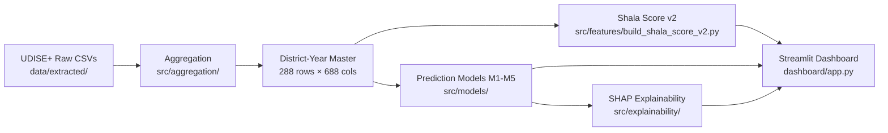

# ShalaScope Maharashtra

**District-Level School Education Intelligence · UDISE+ Real Government Data**

> *Every number traceable. Every gap declared.*


---

## The Idea

Maharashtra has 36 districts with very different school conditions.
Planners need one transparent, comparable view of where support is needed first.
ShalaScope builds that view entirely from official UDISE+ data — no synthetic
values, no fabricated numbers, no mutation of source files.

---

## At a Glance

| Item | Value |
|---|---|
| Districts | 36 |
| Regions | Konkan · Western Maharashtra · Marathwada · Vidarbha |
| Academic years | 2018-19 to 2025-26 (288 district-year rows) |
| Spec / modelling window | 2019-20 to 2024-25 |
| Edge years | 2018-19 (anchors trends) · 2025-26 (provisional) |
| Dashboard pages | 6 |
| Unit tests | **60 passed** |
| Learning Outcomes pillar | **MISSING\_IN\_SOURCE** — no NAS/ASER/GER data in UDISE+ |

---

## Key Findings

All findings read directly from `reports/`.

- **Vidarbha leads, Marathwada lags.** In 2025-26, the top 3 ranked
  districts (Nagpur 70.3, Wardha 64.6, Chandrapur 62.0) are all in
  Vidarbha; the bottom 3 (Palghar 37.5, Jalna 37.9, Buldana 39.8) span
  Konkan and Marathwada.
  *Source: `reports/score_design/shala_score_v2_latest_ranking.csv`*

- **State average has risen steadily.** Mean Shala Score v2 increased from
  42.8 (2018-19) to 50.8 (2025-26), with the Critical tier shrinking from
  19 districts to 3 over the same period.
  *Source: `reports/score_design/shala_score_v2_yearwise_summary.csv`*

- **Student participation drives risk classification.** The top SHAP driver
  for the M5 risk-tier model is `pillar2_participation` (mean |SHAP| = 0.072),
  followed by `pillar2_infrastructure` (0.057) and `pillar2_digital` (0.048).
  *Source: `reports/explainability/m5_shap_feature_ranking.csv`*

- **Teacher shortage is linked to enrolment size, not region.** The top SHAP
  driver for the M4 teacher-shortage model is
  `enrollment_reported_student_total` (mean |SHAP| = 0.148) — larger districts
  face proportionally higher PTR risk regardless of region.
  *Source: `reports/explainability/m4_shap_feature_ranking.csv`*

- **Total enrolment forecast is highly stable (R²=0.997).** Holt-Winters
  per-district time-series forecasts for M3 achieve near-perfect hold-out
  accuracy, confirming strong intra-district enrolment continuity.
  *Source: `reports/models/all_modules_metrics_summary.csv`*

---

## How It Works



---

## Methodology in 3 Lines

1. **Chronological split** — train 2018-19 to 2023-24 (216 rows), test 2024-25
   (36 rows), forecast horizon 2025-26 / 2026-27 (never seen during training).
2. **Proportional weight redistribution** — when a pillar's source data is
   absent, `eff_w_i = nominal_w_i / Σ(nominal_w_j for available j)`.
   Learning Outcomes pillar weight = 0% (MISSING\_IN\_SOURCE, constant across
   all 288 rows).
3. **Proxy labelling** — M2 uses `pillar2_infrastructure` as a
   `SUBSTITUTE_PROXY`; M5 is labelled "Classroom Infrastructure Quality Trend
   (Documented Proxy)" — neither is a learning-outcome or dropout predictor.

---

## Shala Score v2 — Pillar Design

| Pillar | Nominal weight | Effective weight | Source columns |
|---|---|---|---|
| Teacher PTR | 25% | **29.4%** | `ptr_students_per_teacher_raw` |
| Infrastructure | 25% | **29.4%** | `functional_toilet_pct_raw`, `good_classroom_pct_raw` |
| Participation | 20% | **23.5%** | Boys + Girls enrolment, SC/ST/OBC breakdown |
| Digital Readiness | 15% | **17.6%** | `facility_avg_digital_devices_per_reporting_school` |
| **Learning Outcomes** | **15%** | **0% — MISSING\_IN\_SOURCE** | No NAS/ASER/GER/dropout data in UDISE+ |

Score range observed: **24.9 – 72.2** across 288 district-years.
Four equal-size risk tiers: Critical · At-Risk · Stable · Thriving (72 each).

> No double-counting: `facility_classrooms_good_condition_pct` appears in
> Infrastructure only and is never reused in the Learning pillar.

---

## Prediction Modules

| ID | Model | Target | Test metric | Leakage guard |
|---|---|---|---|---|
| M1 | LinearRegression | Total enrolment | R²=0.778 | PTR excluded |
| M2 | Ridge | `pillar2_infrastructure` **(SUBSTITUTE\_PROXY)** | R²=0.520 | No learning data fabricated |
| M3 | Holt-Winters per district | Total enrolment | R²=0.997 | Fitted on train history only |
| M4 | RandomForest | PTR > 30 (teacher shortage) | Acc=0.972 · F1=0.973 | PTR is target, not feature |
| M5 | RandomForest | `risk_tier_v2` **(Classroom Infra Proxy)** | Acc=0.694 · F1=0.671 | `shala_score_v2` excluded |

Train: 2018-19 to 2023-24 · Test: 2024-25 · Forecast: 2025-26 / 2026-27

---

## Dashboard Pages

`streamlit run dashboard/app.py` — 6 pages, left-sidebar navigation:

| # | Page | Key content |
|---|---|---|
| 1 | **Overview** | Hero KPIs, top/bottom 10, score trend, choropleth map, data principles |
| 2 | **Region Comparison** | Konkan / W. Mah / Marathwada / Vidarbha — scores, risk tiers, pillar heatmap |
| 3 | **District Explorer** | v2 risk tier badge, SHAP top driver, ratio bars, forecast, indicator analytics, audit heatmap |
| 4 | **District Grouping** | K-Means 4-cluster profiles (Thriving/Stable/At-Risk/Critical), elbow/silhouette |
| 5 | **Predictive Intelligence** | M1-M5 outputs, SHAP feature drivers, What-If simulator, Auto-Optimize Top 3 |
| 6 | **Data & Methodology** | AVAILABLE vs MISSING\_IN\_SOURCE audit, coverage heatmap, score formula |

---

## Screenshots

> **TODO — capture and place these files before submission:**

| File | Page to capture |
|---|---|
| `docs/screenshots/01_overview.png` | Overview page (choropleth map visible) |
| `docs/screenshots/02_region_comparison.png` | Region Comparison — risk tier stacked bar |
| `docs/screenshots/03_district_explorer.png` | District Explorer — PUNE, ratio bars visible |
| `docs/screenshots/04_district_grouping.png` | District Grouping — cluster radar chart |
| `docs/screenshots/05_predictive_intelligence.png` | Predictive Intelligence — M1-M5 metrics tab |
| `docs/screenshots/06_data_methodology.png` | Data & Methodology — coverage heatmap |

---

## Integrity by Design

| Rule | Implementation |
|---|---|
| **No synthetic data** | All numbers from UDISE+; missing columns documented as `MISSING_IN_SOURCE` |
| **No source mutation** | `data/extracted/` and `data/processed/` are read-only; outputs land in `reports/` |
| **No double-counting** | Classroom quality in Infrastructure pillar only |
| **No future leakage** | Strict chronological train/test split; forecast horizon never seen |
| **Proxy transparency** | M2 `SUBSTITUTE_PROXY` label; M5 "Classroom Infra Quality Trend (Documented Proxy)" label |

---

## Quick Start

> Requires Python 3.11, Windows PowerShell (or equivalent).

```powershell
# 1. Clone
git clone https://github.com/sandipk765/shalascope-maharashtra.git
cd shalascope-maharashtra

# 2. Create and activate virtual environment
python -m venv .venv
.venv\Scripts\Activate.ps1

# 3. Install dependencies
pip install -r requirements.txt

# 4. Run unit tests (expect: 60 passed, 1 warning)
python -m pytest tests/ -v

# 5. Launch dashboard
streamlit run dashboard/app.py
```

> **Note:** `data/extracted/` (raw UDISE+ CSVs) is excluded from the
> repository via `.gitignore`. The dashboard reads from
> `data/processed/district_year/` which is included.

---

## Project Structure

```
shalascope-maharashtra/
├── dashboard/
│   └── app.py                   Streamlit app (2 189 lines, 6 pages)
├── data/
│   └── processed/district_year/ Scored CSVs: v1 (677 cols), v2 (688 cols), forecast
├── docs/
│   ├── data_log.md / .xlsx      Column availability audit (14 available, 12 missing)
│   └── screenshots/             TODO: add before submission
├── models/                      5 × .joblib artifacts (M1-M5)
├── notebooks/                   01-05 exploratory notebooks
├── reports/
│   ├── explainability/          SHAP values, rankings, top-driver CSVs
│   ├── models/                  Per-module CSVs + all_modules_metrics_summary.csv
│   └── score_design/            Normalization params, weights, PCA, ranking
├── src/
│   ├── core/regions.py          36-district region map, GPI, marginalised %
│   ├── features/                build_shala_score_v1/v2, data log
│   ├── models/                  M1-M5, K-Means, RF risk factor, rootcause
│   ├── explainability/          SHAP wrapper (graceful fallback)
│   ├── features.py              Column name constants (single source of truth)
│   └── prescriptive.py          validate_temporal_forecast, recommend_top_interventions
├── tests/
│   ├── test_regions.py          14 tests — region map, GPI, marginalised %
│   ├── test_score_v2.py         14 tests — shape, range, tiers, no fabrication
│   └── test_prescriptive.py     32 tests — forecast, interventions, tier boundaries
└── requirements.txt
```

---

## Limitations

- **No learning outcome data.** NAS, ASER, GER, and dropout rate are absent
  from the UDISE+ extract. M2 and M5 use infrastructure proxies, clearly labelled.
- **Small N.** 36 districts × 6 train years = 216 training rows. M4/M5
  classifier generalisation is limited; treat results as indicative.
- **2025-26 is provisional.** That year's values should be re-verified once
  UDISE+ officially releases the data.
- **Shala Score is not a government-certified ranking.** It is an analytical
  index for research purposes only.
- **SHAP values indicate statistical association, not causation.**

---

## Project Info

| Field | Value |
|---|---|
| **Title** | ShalaScope Maharashtra — District-Level School Education Intelligence |
| **Data source** | UDISE+ (Unified District Information System for Education Plus), Government of India |
| **Institution** | *[TODO: fill in]* |
| **Programme** | *[TODO: fill in]* |
| **Guide / Supervisor** | *[TODO: fill in]* |
| **Author** | *[TODO: fill in]* |
| **Repository** | https://github.com/sandipk765/shalascope-maharashtra |
| **Year** | 2026 |
