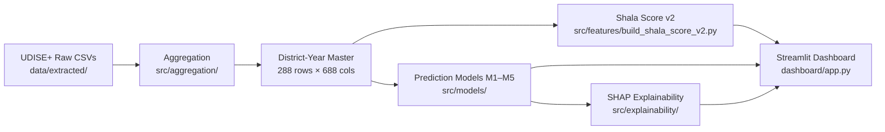

# ShalaScope Maharashtra

**District-Level School Education Intelligence · UDISE+ Real Government Data**

> *Every number traceable. Every gap declared.*

Maharashtra has 36 districts with very different school conditions.
ShalaScope builds one transparent, comparable view of where support is needed first —
entirely from official UDISE+ data, with every gap explicitly declared.

---

## Key Findings

| Finding | Value | Source |
|---|---|---|
| Score range (all years) | 24.9 – 72.2 | `score_design/shala_score_v2_yearwise_summary.csv` |
| State mean trend *(provisional for 2025-26)* | 42.8 (2018-19) → 50.8 (2025-26) | same file |
| Critical-tier districts | 19 (2018-19) → 3 (2025-26, **provisional**) | same file |
| Top district 2025-26 *(provisional)* | Nagpur, Vidarbha — 70.3 | `score_design/shala_score_v2_latest_ranking.csv` |
| Bottom district 2025-26 *(provisional)* | Palghar, Konkan — 37.5 | same file |
| M5 top SHAP driver | `pillar2_participation` (mean \|SHAP\| = 0.072) | `explainability/m5_shap_feature_ranking.csv` |
| M4 top SHAP driver | `enrollment_reported_student_total` (0.148) | `explainability/m4_shap_feature_ranking.csv` |

---

## How It Works

**Methodology:**
- **Chronological split** — train 2018-19 → 2023-24 (216 rows), test 2024-25 (36 rows); forecast 2025-26 / 2026-27 never seen.
- **Weight redistribution** — `eff_w_i = nominal_w_i / Σ(nominal_w_j for available j)`; Learning = 0% (MISSING\_IN\_SOURCE).
- **Proxy labelling** — M2 is `SUBSTITUTE_PROXY`; M5 is "Classroom Infra Quality Trend (Documented Proxy)". Neither predicts learning outcomes or dropout.

---

## Shala Score v2 — Pillar Design

Score range: **24.9 – 72.2** across 288 district-years.
Four equal-size risk tiers (72 districts each): Critical · At-Risk · Stable · Thriving.

| Pillar | Nominal | Effective | Source column(s) |
|---|---|---|---|
| Teacher PTR | 25% | **29.4%** | `ptr_students_per_teacher_raw` |
| Infrastructure | 25% | **29.4%** | `functional_toilet_pct_raw`, `good_classroom_pct_raw` |
| Participation | 20% | **23.5%** | Boys + Girls enrolment, SC/ST/OBC breakdown |
| Digital Readiness | 15% | **17.6%** | `facility_avg_digital_devices_per_reporting_school` |
| **Learning Outcomes** | **15%** | **0% — MISSING\_IN\_SOURCE** | No NAS/ASER/GER/dropout in UDISE+ |

> `facility_classrooms_good_condition_pct` is in Infrastructure only — never reused in Learning.

---

## Prediction Modules

Train: 2018-19 → 2023-24 (216 rows) · Test: 2024-25 (36 rows)

| ID | Model | Target | Test metric | Leakage guard |
|---|---|---|---|---|
| M1 | LinearRegression | Total enrolment | R²=0.778 | PTR not a feature |
| M2 | Ridge | `pillar2_infrastructure` **(SUBSTITUTE\_PROXY)** | R²=0.520 | No learning data fabricated |
| M3 | Holt-Winters per district | Total enrolment | R²=0.997 | Fitted on train history only |
| M4 | RandomForest | PTR > 30 (shortage) | Acc=0.972 · F1=0.973 | PTR is target, not feature |
| M5 | RandomForest | `risk_tier_v2` **(Classroom Infra Proxy)** | Acc=0.694 · F1=0.671 | `shala_score_v2` excluded |

---

## Dashboard Pages

`streamlit run dashboard/app.py` — 6 pages, left-sidebar navigation, Pune default.

| # | Page | Key content |
|---|---|---|
| 1 | **Overview** | KPIs, top/bottom-10 bar charts, score trend, choropleth map |
| 2 | **Region Comparison** | Konkan / W. Mah / Marathwada / Vidarbha — scores, risk tiers, pillar heatmap |
| 3 | **District Explorer** | v2 risk tier, SHAP top driver, ratio bars, forecast, indicator analytics |
| 4 | **District Grouping** | K-Means 4-cluster profiles, elbow/silhouette chart |
| 5 | **Predictive Intelligence** | M1-M5 outputs, SHAP drivers, What-If simulator, Auto-Optimize Top 3 |
| 6 | **Data & Methodology** | AVAILABLE vs MISSING\_IN\_SOURCE audit, coverage heatmap, score formula |

---

## Integrity by Design

| Rule | Implementation |
|---|---|
| No synthetic data | All values from UDISE+; absent columns documented as `MISSING_IN_SOURCE` |
| No source mutation | `data/extracted/` and `data/processed/` are read-only |
| No double-counting | Classroom quality in Infrastructure pillar only |
| No future leakage | Strict chronological split; forecast horizon never in training |
| Proxy transparency | M2 `SUBSTITUTE_PROXY`; M5 "Classroom Infra Quality Trend (Documented Proxy)" |

---

## Limitations

- **No learning outcome data.** NAS/ASER/GER/dropout are absent from UDISE+. M2 and M5 use documented proxies.
- **Small N.** 36 districts × 6 train years = 216 rows. Treat M4/M5 classifier results as indicative.
- **2025-26 values are provisional** until UDISE+ officially confirms the release.
- **Shala Score is an analytical index**, not a government-certified ranking.
- **SHAP values show statistical association**, not causal direction.

---

## Future Work

- Integrate NAS/ASER learning-outcome data when available to activate the Learning pillar.
- Add school-level drilldown within each district for finer-grained intervention targeting.
- Automate yearly dataset refresh and model retraining via a scheduled pipeline.

---

## Project Info

| Field | Value |
|---|---|
| **Title** | ShalaScope Maharashtra — District-Level School Education Intelligence |
| **Data source** | UDISE+ (Unified District Information System for Education Plus), Govt. of India |
| **Institution** | Department of Technology, Savitribai Phule Pune University (SPPU) |
| **Programme** | B.Sc. (Honours) in Data Science  |
| **Author** | Sandip Khamkar |
| **Repository** | https://github.com/sandipk765/shalascope-maharashtra |
| **Year** | 2026 |
